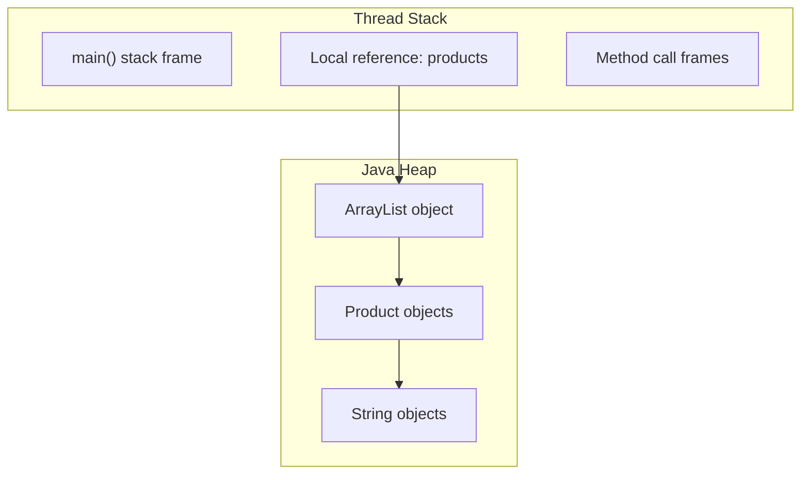

# Day 10 - Memory Management

## Objective

Understand Java stack and heap memory, garbage collection, string performance, and common memory-related pitfalls through hands-on experiments.

## Environment

- Language: Java
- Java Version: Java 21
- Operating System: Windows
- Compiler validation: `javac -Xlint:all -Werror`

## Experiments and Results

### Experiment 1: StackOverflowError and Stack Size

**Objective:** Observe how thread stack size affects recursive method calls.

**Method:** A recursive method calls itself repeatedly until the JVM throws `StackOverflowError`. The experiment was run with the default stack size, `-Xss256k`, and `-Xss1m`.

| Stack configuration | Recursive calls before failure |
|---|---:|
| Default | 16,129 |
| `-Xss256k` | 2,697 |
| `-Xss1m` | 16,026 |

**Observation:** The smaller stack allowed fewer recursive calls before failure. A larger stack generally allows more calls. The exact number depends on JVM settings and execution details.

**Conclusion:** `-Xss` configures the thread stack size. Deep or unbounded recursion can cause `StackOverflowError`.

### Experiment 2: OutOfMemoryError

**Objective:** Observe heap exhaustion with a maximum heap size of 64 MiB.

**Command:**

```powershell
java -Xmx64m MemoryLab
```

**Result:**

- Byte-array payload retained before failure: 31 MiB.
- Error: `java.lang.OutOfMemoryError: Java heap space`.

**Observation:** The program stored 1 MiB byte arrays in a list, keeping references to them and preventing them from becoming eligible for garbage collection.

**Conclusion:** `-Xmx64m` limits the Java heap to approximately 64 MiB. The heap also contains other objects and runtime data, so the retained byte-array payload can be smaller than the configured heap limit.

### Experiment 3: String Concatenation vs StringBuilder

**Objective:** Compare the time required to construct the same string using `String +=` and `StringBuilder`.

**Iterations:** 20,000

| Method | Execution time | Result length |
|---|---:|---:|
| `String +=` | 341.784 ms | 88,890 |
| `StringBuilder` | 2.801 ms | 88,890 |

**Result:** Both methods produced matching strings.

**Observation:** In this run, `StringBuilder` was approximately 122 times faster than repeated `String +=` concatenation.

**Conclusion:** Strings are immutable. Repeated concatenation in a loop can create many intermediate strings. `StringBuilder` uses a mutable buffer and is generally more efficient for repeated string construction. Timings vary between runs.

### Experiment 4: Garbage Collection Logging

**Objective:** Observe garbage collection activity using JVM logging.

**Command:**

```powershell
java -Xlog:gc MemoryLab
```

**Observed results:**

- The JVM reported the G1 garbage collector.
- Young garbage collection events occurred.
- Full garbage collection events occurred following `System.gc()` requests.
- Logs showed heap occupancy before and after collection, pause durations, and heap capacity.

**Example log:**

```text
[info][gc] Using G1
[info][gc] GC(0) Pause Full (System.gc()) 42M->0M(8M) 11.395ms
```

**Observation:** The heap occupancy decreased after garbage collection reclaimed objects that were no longer reachable.

**Conclusion:** Garbage collection reclaims memory occupied by unreachable objects. `System.gc()` requests collection but does not guarantee that collection will occur immediately. Log details depend on JVM behavior and heap configuration.

### Experiment 5: Integer Cache and the `==` Operator

**Objective:** Understand the difference between reference comparison and value comparison for `Integer` objects.

**Code example:**

```java
Integer a = 100;
Integer b = 100;

Integer c = 200;
Integer d = 200;

System.out.println(a == b);
System.out.println(a.equals(b));

System.out.println(c == d);
System.out.println(c.equals(d));
```

**Expected output under the standard Java 21 configuration:**

```text
true
true
false
true
```

**Observation:** Autoboxed integers in the guaranteed cache range, typically `-128` through `127`, can share cached objects. The values `100` and `200` demonstrate why reference equality should not be used for numeric value comparisons.

**Conclusion:** The `==` operator compares object references, while `.equals()` compares the values for `Integer`. Use `.equals()` when comparing wrapper values.

## Stack and Heap Diagram

The following diagram illustrates a business method that loads products into a collection.



**Explanation:**

- The stack stores method frames, local variables, and references used during method execution.
- The heap stores objects such as `ArrayList`, `Product`, and `String`.
- The `products` local reference points to an `ArrayList` object on the heap.
- The list holds references to product objects.
- Objects that are no longer reachable can become eligible for garbage collection.
- Actual memory layout may differ due to JVM optimizations.

## Memory Management Concepts

### Stack vs Heap

| Stack | Heap |
|---|---|
| Organized around thread method execution | Stores Java objects and arrays |
| Contains stack frames and local variables | Contains objects referenced by the program |
| Limited per-thread stack capacity | Governed by the configured heap and JVM memory management |
| Excessive recursion can cause `StackOverflowError` | Excessive retained allocations can cause `OutOfMemoryError` |

### Garbage Collection Basics

Garbage collection identifies objects that are no longer reachable from live references and can reclaim their memory.

- **Young generation:** Commonly handles newly allocated objects.
- **Old generation:** Holds objects that survive long enough to be promoted.
- **Minor/young GC:** Collects the young generation.
- **Major GC:** A term often used for collection involving the old generation; exact terminology depends on the collector.
- **Full GC:** A broader collection that may involve multiple heap regions or generations.

The exact collection process depends on the garbage collector. G1 was observed in this experiment.

## CMS Project Memory Review Notes

The following are review checks for the Blog & Content Publishing Platform. They should be verified against the implementation rather than assumed to be existing defects.

1. **Growing static collections:** Avoid storing requests, sessions, comments, or analytics events indefinitely in static collections. Remove entries when they are no longer needed.
2. **Unclosed resources:** Use try-with-resources for files, streams, and other `AutoCloseable` resources.
3. **String concatenation:** Prefer `StringBuilder` when constructing large strings repeatedly in loops, such as reports or exported CSV data.
4. **Integer comparison:** Use `.equals()` to compare wrapper values instead of relying on reference equality with `==`.
5. **Unbounded recursion:** Avoid recursion that can continue indefinitely. Validate inputs and consider iteration when appropriate.
6. **Excessive object retention:** Keep references only as long as necessary, particularly in caches, collections, and analytics processing.
7. **Large CSV imports:** Process large files incrementally rather than loading the entire file into memory when it is unnecessary.

## How to Compile and Run

Compile with strict warning checks:

```powershell
javac -Xlint:all -Werror MemoryLab.java
```

Run the experiments individually using the corresponding implementation in `MemoryLab.java`:

```powershell
java -Xss256k MemoryLab
java -Xss1m MemoryLab
java -Xmx64m MemoryLab
java -Xlog:gc MemoryLab
java MemoryLab
```

For the stack, heap, string, GC, and Integer experiments, select the corresponding experiment code before running if the file contains only one experiment at a time. If using a combined command-line-driven `MemoryLab`, use the experiment arguments documented in the source code.

## Key Learnings

- Stack size affects the number of recursive calls a thread can make.
- Heap exhaustion can occur before the configured maximum heap is fully occupied by application payload.
- `StringBuilder` can significantly improve performance for repeated string construction.
- GC logs help explain collection events, pause times, and heap occupancy changes.
- `==` compares object references, while `.equals()` compares `Integer` values.
- Garbage collection helps reclaim unreachable objects, but it does not replace proper resource management.
- Strict compilation helps detect warnings and maintain code quality.

## Deliverables

- `MemoryLab.java`
- `README.md` with experiment results, explanations, and a stack/heap diagram.

## Completion Criteria

- [x] Stack size experiment completed.
- [x] Heap exhaustion experiment completed with `-Xmx64m`.
- [x] String concatenation performance comparison completed.
- [x] Garbage collection logging observed using `-Xlog:gc`.
- [x] Integer cache behavior examined.
- [x] Memory pitfalls and stack/heap concepts documented.